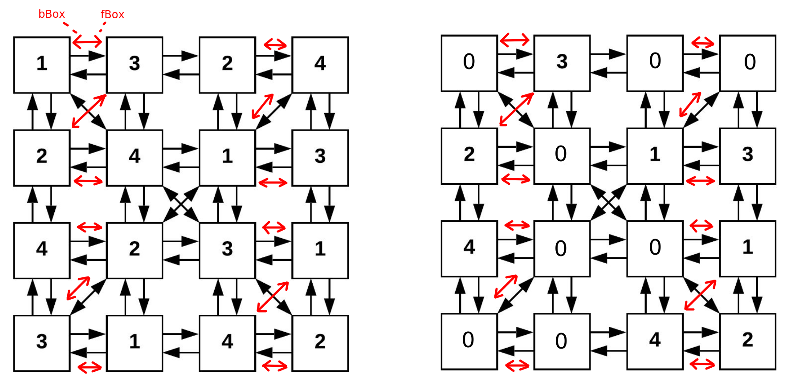
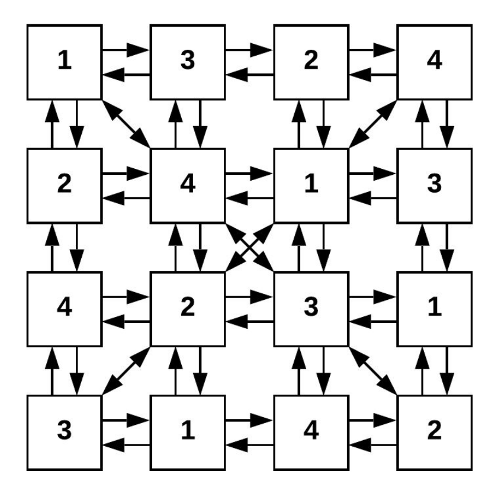
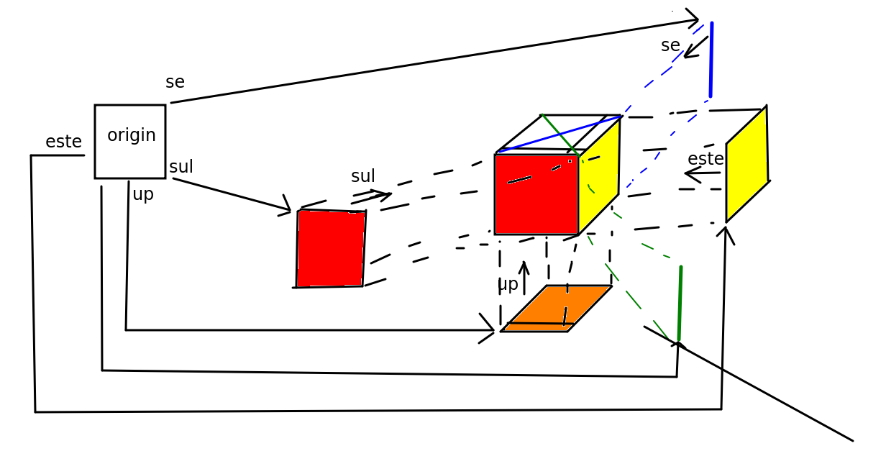
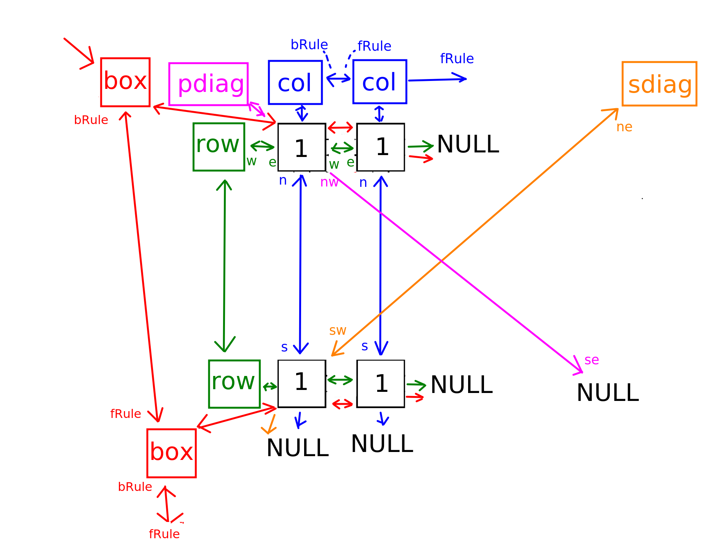
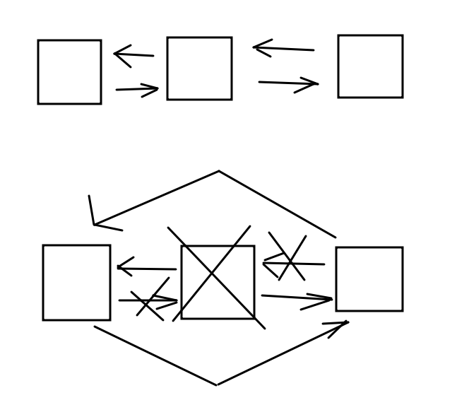
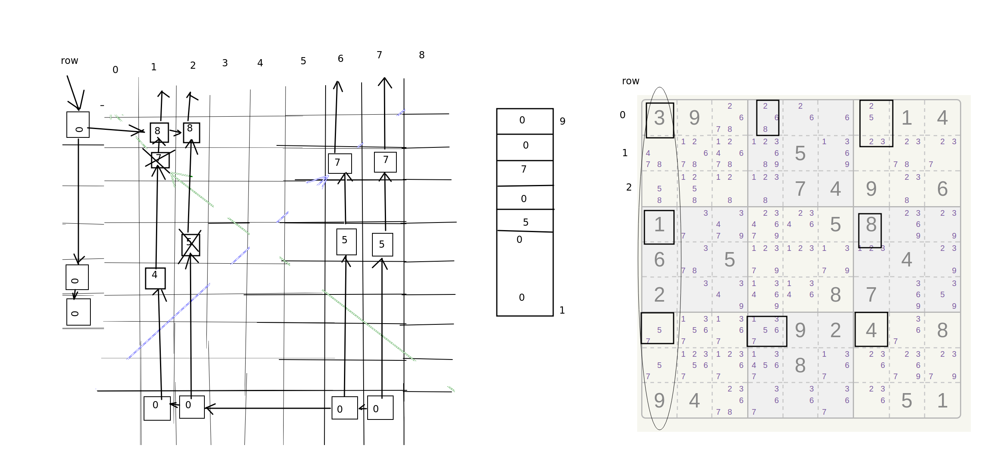
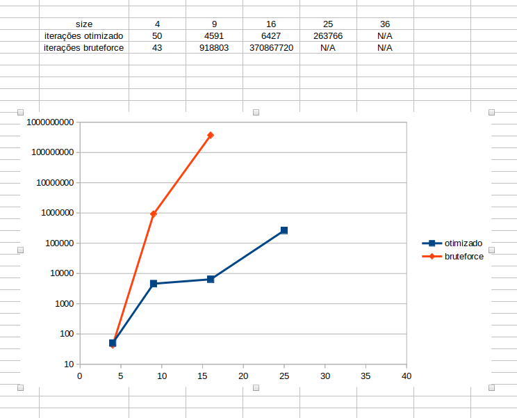

# Sudoku X Solver

[](https://github.com/filipeoliv02/Sudoku_X_Solver/actions/workflows/ci.yml)

A **Sudoku X (diagonal Sudoku)** generator and solver written in C, for boards from **4x4 up to 36x36**. It started as a
university project for *Programming Languages I* and *Algorithms and Data Structures I* (LP1/AED1).

The project solves the same problem **twice, with two different data-structure philosophies**, and implements several
solving algorithms on top of each. You can compare naive search with constraint propagation and human-style solving
strategies:

| Phase | Board representation | Algorithms |
|-------|----------------------|------------|
| **Phase 1** (`fase1/`) | Dynamically allocated 2-D arrays (`int **`) | Backtracking brute force; *optimized* solver based on a 3-D candidate matrix (hidden/naked singles + naked pairs) |
| **Phase 2** (`fase2/`) | Fully linked graph of cells (orthogonal + diagonal + region links) | Backtracking on the graph; *optimized* solver on a 3-D linked candidate structure (singles, intersection removal, naked groups, X-Wing) |

Both phases also include board **generation**, **consistency checking**, **searching** stored solutions, **sorting**
boards by size, and **text and binary persistence**.

---

## Table of contents

- [Sudoku X rules](#sudoku-x-rules)
- [Algorithms and techniques](#algorithms-and-techniques)
  - [Phase 1: arrays](#phase-1--arrays)
  - [Phase 2: linked structures](#phase-2--linked-structures)
  - [Performance comparison](#performance-comparison)
- [Building, running and testing](#building-running-and-testing)
- [File formats](#file-formats)
- [Project structure](#project-structure)
- [Engineering notes](#engineering-notes)

---

## Sudoku X rules

An `N x N` board (`N` a perfect square: 4, 9, 16, 25, 36…) is divided into `√N x √N` boxes. Fill every cell with a
number from `1` to `N` so that each number appears **exactly once** in:

1. every **row**;
2. every **column**;
3. every **box**;
4. both **main diagonals** (top-left → bottom-right and top-right → bottom-left). This rule is what makes it Sudoku **X**.

> **Project rule:** the diagonal constraint applies to boards up to **16x16**
> (`SUDOKUX_MAX_DIAGONAL_SIZE` in [`common/sudoku_common.h`](common/sudoku_common.h)). Bigger boards (25x25, 36x36) are
> solved as classic Sudoku. With the extra diagonal constraints, random and sparse large boards were impractical to
> generate and solve.

In the input files `0` means an empty cell.

---

## Algorithms and techniques

`N` is the board side and `E` the number of empty cells. The solvers count the work they do in a `cost` counter: one
unit per candidate tried or strategy step. That makes the algorithms comparable independently of the machine.

### Phase 1: arrays

#### 1. Backtracking brute force

- **What:** depth-first search over the empty cells in row-major order. For each empty cell it tries `1..N`, recurses
  when the placement is legal, and undoes the placement on the way back.
- **How:** [`solveSudokuBruteForce`](fase1/algorithms.c) works *in place* on the board (no copies per recursion level).
  [`isValidPlacement`](fase1/algorithms.c) checks the column, the row, the box and, if the cell lies on one, the
  diagonal(s). The diagonal checks only run when `row == col` or `row + col == N - 1`, so most cells skip them. Every
  complete board reached is deduplicated and appended to the list of solutions, so the solver **enumerates every
  solution**, not just the first.
- **Complexity:** `O(N^E)` worst case in time, each step costing `O(N)` for the validity check. Memory is `O(E)`
  recursion depth.
- **Trade-off:** simple and always correct, but exponential. In practice it's fine for 4x4/9x9 and becomes very slow
  for sparse 16x16 boards.

#### 2. Optimized solver: candidate cube with constraint propagation

- **What:** keeps, for every number, which cells it can still go in. It then applies logical deductions until nothing
  changes, and only falls back to brute force for what's left.
- **How:** [`solveSudokuOptimized`](fase1/algorithms.c) builds a **3-D candidate matrix** ("cube"): `N` layers of
  `N x N`, where `cube[k][r][c] == 1` means *number `k+1` can't go in `(r, c)`*.
  - [`sudokuFillCell`](fase1/algorithms.c) places a value. It marks the row, column, box and diagonals of that number's
    layer, and the same cell in every layer.
  - [`checkSudokuCell`](fase1/algorithms.c) detects **hidden singles** (a number with only one free cell left in a row,
    column, box or diagonal of its layer) and **naked singles** (a cell with only one number left across the layers).
  - When a sweep makes no progress, [`findPairs`](fase1/algorithms.c) looks for **naked pairs**: two cells in the same
    column, row, diagonal or box with the same two candidates. It removes those candidates from the rest of the unit and
    sweeps again.
  - Whatever the deductions can't solve is passed, partially filled, to the brute force solver. That fallback finds
    the remaining solutions and verifies the result.
- **Complexity:** one sweep is `O(N^3)` (cell, number) pairs × `O(N)` per check = `O(N^4)`. The cube uses `O(N^3)` memory.
- **Trade-off:** more memory and code in exchange for orders of magnitude less search (see the
  [benchmark](#performance-comparison)).

#### 3. Supporting algorithms

| Technique | Where | Notes |
|-----------|-------|-------|
| **Consistency check** | [`isConsistent`](fase1/utils.c) | Temporarily clears each filled cell and re-checks it with `isValidPlacement`. `O(N^3)`. Run before solving so contradictory boards aren't searched. |
| **Random generation** | [`gen_sudoku`](fase1/utils.c) | Rejection sampling: random `(row, col, value)` triples, accepted only if legal. Bounded number of attempts. |
| **Counting sort** | [`computeOrderBySize`](fase1/algorithms.c) | Builds an index of the stored boards ordered by size in `O(n + k)` without moving the boards. |
| **Pattern search** | [`searchSudokus` / `isPattern`](fase1/algorithms.c) | Finds a stored solution that matches an unsolved board, treating `0` as a wildcard. |
| **Growable arrays** | [`resizeSudokus` / `resizeList`](fase1/utils.c) | Lists of boards grown with `realloc`. |
| **Text / binary persistence** | [`fileio.c`](fase1/fileio.c) | Merges with existing files without duplicating boards. |

### Phase 2: linked structures

#### 4. The board as a graph of cells



- **What:** every cell is a `Node` linked to its neighbours in **8 directions** (`n, ne, e, se, s, sw, w, nw`). Cells in
  the same box are also chained with `fBox` / `bBox` (forward/backward in the box).

  

- **How:** [`createEmptySudokuLinked`](fase2/utils_linked.c) wires the graph row by row. Diagonal links exist only on
  the two main diagonals, so **walking a unit means following one pointer until `NULL`**, with no index arithmetic.
- **Key technique: direction as a function pointer.** Navigation is abstracted by functions like
  `nodeE`, `nodeS`, `nodeSE`, `nodeFBOX`… ([`algorithms_linked.c`](fase2/algorithms_linked.c)). A single generic routine
  handles every rule. For example, [`isValidPlacementLinked`](fase2/algorithms_linked.c) is
  `isValidPlacementInDirection(node, num, nodeE) && … nodeW … nodeS … nodeN … nodeSE … nodeFBOX …`, and the same idea
  drives every strategy below.

#### 5. Backtracking on the graph

[`solveLinkedSudokuBruteForce`](fase2/algorithms_linked.c) is the same DFS as in phase 1, but it moves to the next
cell through the `e`/`s` links and validates by walking the 10 directions. Every solution is **cloned** into a FIFO
queue of boards ([`enqueueSudoku`/`dequeueSudoku`](fase2/utils_linked.c)).

#### 6. 3-D linked candidate structure



- **What:** the linked equivalent of the phase-1 cube, but **sparse**: a candidate exists as a node only while it's
  still possible, so eliminating a candidate frees memory.
- **How:** [`createCandidates`](fase2/algorithms_linked.c) builds `N` layers (one per number) of `N x N` nodes,
  plus a base layer, all linked vertically with `ascend` / `descend`. An `origin` node gives access to a list of
  **rule header nodes** for each rule (rows, columns, boxes, main diagonal, anti-diagonal, and the base-layer "cells"),
  chained with `fRule` / `bRule`. Each header points to the first candidate of its unit:

  

  So "the candidates for number 7 in column 3" or "all candidates of cell (2, 5)" is a short pointer walk.

#### 7. O(1) candidate elimination (dancing-links style unlinking)



[`disconnectNode`](fase2/algorithms_linked.c) removes a node by reconnecting its neighbours to each other in all 14
directions. The idea is the same as Knuth's *Dancing Links*. Placing a number
([`removeConnectedNodes`](fase2/algorithms_linked.c)) removes every candidate it rules out by walking outwards in all
directions. Unlike DLX, removed nodes are freed rather than kept for restoring. The deductive phase never backtracks,
and any remaining search runs on the board, not on the candidate structure.

#### 8. Human-style solving strategies

[`solveLinkedSudokuOptimized`](fase2/algorithms_linked.c) runs the strategies **in order of cost and goes back to the
cheapest one after any success**:

```c
while (stratSingles(...) || stratIntersectionRemoval(...) || stratNakedGroups(...) || stratXWing(...)) {
    if (!isPossible(...)) { /* contradiction: board has no solution */ }
}
```

| Strategy | Function | What it does | Complexity (per pass) |
|----------|----------|--------------|------------------------|
| **Hidden / naked singles** | `stratSingles` → `checkSingles` | A rule header with exactly one candidate left means that candidate is forced. This covers hidden singles in rows, columns, boxes and diagonals, and naked singles through the cell layer (`ascend`). | `O(N^2)` |
| **Intersection removal** | `stratIntersectionRemoval` → `checkIntersectionRemoval`, `clearIntersection` | *Pointing groups*: candidates of a box confined to one row/column/diagonal remove that number from the rest of the line. *Box/line reduction*: the reverse. Applied to rows, columns and both diagonals. | `O(√N · N^2)` |
| **Naked groups** (pairs, triples, quads) | `stratNakedGroups` → `checkNakedGroups`, `findGroup`, `removeGroupNodes` | If `k` cells in a unit hold only `k` distinct candidates between them, those numbers can be removed from the rest of the unit. `findGroup` is a **recursive combination search** that tracks the union of candidates in a counting array (`dict[0]` holds the number of distinct values). Limited to quads (`FLAG_DYNAMIC_GROUPS = 0`) or up to `N/2`. | `O(N · N!)` worst case, bounded in practice by the group limit |
| **X-Wing** | `stratXWing` → `checkXWing`, `removeXWing` | If a number appears in exactly two cells in each of two rows, in the same two columns, it can be removed from the rest of those columns (and the same with rows and columns swapped). | `O(N^3)` |
| **Contradiction detection** | `isPossible`, `isRuleConsistent` | A rule header with no candidates left means the board is impossible, so the solver stops early. | `O(N^2)` |



If the strategies can't finish the board, the partially solved board is passed to the linked brute force solver.

#### 9. Other phase-2 techniques

- **Consistency check** ([`isConsistentLinked`](fase2/utils_linked.c)) and **random generation**
  ([`generateRandomSudokuLinked`](fase2/utils_linked.c)) on the graph.
- **Deep cloning** of a linked board ([`cloneSudoku`](fase2/utils_linked.c)).
- **Text and binary persistence** of board queues ([`fileio_linked.c`](fase2/fileio_linked.c)).

### Performance comparison

Average `cost` (iterations) per board size from the original analysis
([`docs/algorithms_graph.ods`](docs/algorithms_graph.ods)). Lower is better, and the scale is logarithmic:



| Size | Optimized | Brute force |
|------|-----------|-------------|
| 4x4 | 50 | 43 |
| 9x9 | 4 591 | 918 803 |
| 16x16 | 6 427 | 370 867 720 |
| 25x25 | 263 766 | — |

Reproduce with `./build/sudoku --client compare` (optimized only) or `--client compare-all` (includes brute force, which
takes a long time on 16x16).

---

## Building, running and testing

### Requirements

- CMake ≥ 3.20
- A C11 compiler (GCC or Clang). The code uses POSIX `clock_gettime`, so on Windows use WSL or MinGW.

### Build

```bash
git clone https://github.com/filipeoliv02/Sudoku_X_Solver.git
cd Sudoku_X_Solver
cmake -S . -B build            # Release by default
cmake --build build --parallel
```

Options: `-DSUDOKU_ENABLE_SANITIZERS=ON` (AddressSanitizer + UndefinedBehaviorSanitizer) and
`-DSUDOKU_WARNINGS_AS_ERRORS=ON`. Builds are warning-free with `-Wall -Wextra -Wpedantic -Wshadow -Wformat=2`.

### Run

Run from the repository root, because the menu and the demo clients use paths relative to it.

```bash
# Solve every board in a file (exit code 0 = all solved)
./build/sudoku --solve data/unsolved/unsolved_9x9.txt
./build/sudoku --solve data/unsolved/unsolved_16x16.txt --algorithm linked-optimized
#   algorithms: optimized (default) | bruteforce | linked-optimized | linked-bruteforce

# Run one of the original demo programs ("clients") for each project requirement
./build/sudoku --list-clients
./build/sudoku --client linked-solve-variable-size

# Interactive menu (Portuguese UI): loads ./unsolved.txt, saves ./solved.txt and ./binary_solved.bin
./build/sudoku
```

> Some demo clients write their results back into `data/` and `client_test_files/`, as they did originally.

### Test

```bash
ctest --test-dir build --output-on-failure
```

The test suite ([`tests/test_sudoku.c`](tests/test_sudoku.c)):

- solves the sample puzzles (4x4, 9x9, 16x16, 25x25 and the mixed client files) with **all four solvers**. Every
  reported solution goes through an **independent Sudoku X validator** (rows, columns, boxes, diagonals and the
  original clues). The solvers must agree on whether each board is solvable, and the two brute-force implementations
  must find the same number of solutions;
- feeds **malformed and hostile files** to the loaders: bad or huge sizes, out-of-range values, integer overflow,
  truncated data, broken binary headers. Both loaders must reject them without crashing;
- checks text and binary **round trips** (phase-1 writer → phase-2 reader) and that random generation terminates
  and produces consistent boards.

Sanitizer run:

```bash
cmake -S . -B build-asan -DCMAKE_BUILD_TYPE=Debug -DSUDOKU_ENABLE_SANITIZERS=ON
cmake --build build-asan --parallel && ctest --test-dir build-asan --output-on-failure
```

CI ([`.github/workflows/ci.yml`](.github/workflows/ci.yml)) builds and tests with GCC and Clang in Release and Debug,
and runs the tests, all demo clients and the interactive menu under ASan + UBSan.

### API documentation

The code is documented with Doxygen comments (in Portuguese). Generate the docs with `doxygen doxyfile`; the output goes
to `doxygen/`. A previously generated snapshot is committed in `html/` (open `html/index.html`).

---

## File formats

**Text** (`*.txt`): for each board, its size followed by `size x size` integers (`0` = empty), separated by whitespace:

```
4
1 0 0 0
0 0 0 0
0 0 2 0
0 0 0 0
```

**Binary** (`*.bin`): one unsigned byte with the number of boards, then for each board one byte with its size followed by
`size x size` bytes with the values. Phases 1 and 2 use the same format, so the limit is 255 boards per file.

All input is validated. Sizes must be perfect squares between 4 and 64, values must be within `0..size`, and reading
stops at the first malformed board, keeping the valid ones read before it.

---

## Project structure

| Path | Contents |
|------|----------|
| `main.c` | Entry point: interactive menu and command line options (`--solve`, `--client`) |
| `common/` | Shared size limits, input parsing and checked allocation helpers |
| `fase1/` | Phase 1: array implementation (algorithms, file I/O, menus, demo clients) |
| `fase2/` | Phase 2: linked implementation (graph board, candidate structure, strategies, file I/O, demo clients) |
| `tests/` | CTest test suite |
| `data/`, `client_test_files/` | Sample puzzles (and solutions) used by the demo clients and the tests |
| `unsolved.txt`, `solved.txt` | Files used by the interactive menu |
| `docs/` | Diagrams of the data structures and the algorithm analysis |
| `html/`, `latex/`, `doxyfile` | Doxygen documentation |

---

## Engineering notes

This version updates the original university code (2019/20) without changing its algorithms:

- **Memory safety:** fixed a stack buffer overflow in the counting sort, out-of-bounds reads, NULL dereferences on
  inconsistent boards, reads into uninitialised memory in the binary loader, and many memory leaks. ASan, UBSan and
  LeakSanitizer now report no errors on the tests and on every demo client.
- **Untrusted input:** board sizes and values from files and from the keyboard are validated. Integers are parsed with
  bounded reads and `strtol`, so they can't overflow. The menus handle invalid input and end of input instead of looping
  forever.
- **Correctness:** fixed a copy-paste bug in phase 1's naked-pair elimination (the column branch compared against the
  row index).
- **Tooling:** modern CMake (library + executable + tests), strict warnings, sanitizer option, CTest, GitHub Actions CI
  and Dependabot.
